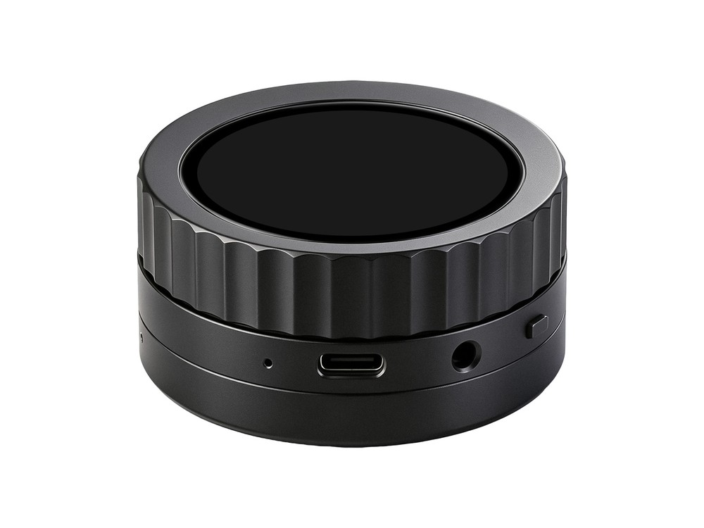

  <h1>ESP32-P4-Knob-Touch-AMOLED-1.75</h1>
  
<strong>ESP32-P4 1.75-inch 466 × 466 MIPI-DSI AMOLED touch knob development board</strong>

  
<strong>English</strong> | <a href="README_ZH.md">简体中文</a>

  

    
    
    
  

  

    <a href="https://www.waveshare.com/wiki/ESP32-P4-Knob-Touch-AMOLED-1.75">🌐 Product</a> &middot;
    <a href="#quick-start">📦 Firmware</a> &middot;
    <a href="examples/esp-idf/">🧩 ESP-IDF</a> &middot;
    <a href="examples/arduino/examples/">🔧 Arduino</a> &middot;
    <a href="#resources">📚 Documentation</a>
  

  

    
  

---

## ✨ Overview

This board combines an ESP32-P4 with a round AMOLED touch display, rotary direction inputs and vibration feedback. This repository provides ESP-IDF and Arduino peripheral examples, plus an ESP-Brookesia factory application.

| Feature | Device / interface |
| --- | --- |
| MCU | ESP32-P4NRW32X |
| Memory | 32 MB Flash, 32 MB PSRAM |
| Display | 1.75-inch, 466 × 466 AMOLED, MIPI-DSI, CO5300 |
| Touch | CST9217, I2C |
| Wireless | ESP32 coprocessor over SDIO |
| Power / time / motion | AXP2101 PMU, PCF85063 RTC, QMI8658 IMU |
| Audio | ES8389 codec, ES7210 microphone ADC; NS4150B amplifier on the adapter |
| Controls | Rotary direction switches, DRV8837 vibration motor driver |
| Storage | microSD interface |
| Board support | ESP Board Manager with one shared YAML board definition |

## 📦 Quick Start

Download the file named `FactoryOnly` from [firmware/](firmware/) to restore the factory demo; follow the [flashing instructions](firmware/README.md). To build from source:

1. Install and activate ESP-IDF using the version in the development environment table below.
2. Download or clone this repository, then open a terminal in the chosen example directory.
3. Connect the board over USB and run `idf.py set-target esp32p4 build flash monitor`.
4. Follow the example README for any required peripherals and expected result; start with [system information](examples/esp-idf/01_system_info/) or build the [factory application](examples/factory/).

For Arduino, install **ESP32 by Espressif Systems** version `3.3.12`, then open a sketch under `examples/arduino/examples/`. Select **ESP32P4 Dev Module** and set Chip Variant to **v3.00 or newer**, Flash Size to **32 MB**, PSRAM to **Enabled**, and Partition Scheme to **32M Flash (13MB APP/6.75MB SPIFFS)**. Copy all contents of `examples/arduino/libraries/`, including `lv_conf.h` and `KnobWireless`, to the Arduino sketchbook libraries folder, or compile with `--libraries examples/arduino/libraries` in Arduino CLI. `KnobWireless` supplies a precompiled ESP32-P4 runtime for this core version; an ESP-IDF installation is not required for these sketches.

## 🧪 Examples

### ESP-IDF

| Example | Main feature |
| --- | --- |
| [01_system_info](examples/esp-idf/01_system_info/) | Chip, Flash, PSRAM and internal memory information |
| [02_buttons](examples/esp-idf/02_buttons/) | BOOT and PWR button state logging |
| [03_wifi](examples/esp-idf/03_wifi/) | Wi-Fi access point scanning |
| [04_bluetooth](examples/esp-idf/04_bluetooth/) | BLE GAP scanning and summaries |
| [05_axp2101](examples/esp-idf/05_axp2101/) | Read-only PMU status display |
| [06_sd_card](examples/esp-idf/06_sd_card/) | microSD mount and temporary-file verification |
| [07_limit_switches](examples/esp-idf/07_limit_switches/) | Two direction-switch indicators |
| [08_motor_drive](examples/esp-idf/08_motor_drive/) | Touch-controlled vibration with automatic stop |
| [09_rtc](examples/esp-idf/09_rtc/) | RTC time display |
| [10_qmi8658](examples/esp-idf/10_qmi8658/) | Accelerometer charts |
| [11_display_touch](examples/esp-idf/11_display_touch/) | RGB display stages and touch drawing |
| [12_mic_spectrum](examples/esp-idf/12_mic_spectrum/) | Microphone FFT spectrum |
| [13_speaker_output](examples/esp-idf/13_speaker_output/) | Speaker test tone playback |
| [14_usb_display](examples/esp-idf/14_usb_display/) | USB display receiver |
| [15_lvgl_demo_v9](examples/esp-idf/15_lvgl_demo_v9/) | LVGL benchmark |
| [16_a2dp_sink](examples/esp-idf/16_a2dp_sink/) | Bluetooth audio receiver and display |

### Arduino

| Example | Main feature |
| --- | --- |
| [01_system_info](examples/arduino/examples/01_system_info/) | Chip, Flash, PSRAM and heap information |
| [02_buttons](examples/arduino/examples/02_buttons/) | BOOT and PWR button state logging |
| [03_wifi](examples/arduino/examples/03_wifi/) | Wi-Fi access point scanning |
| [04_bluetooth](examples/arduino/examples/04_bluetooth/) | Bluetooth LE advertisement scanning |
| [05_axp2101](examples/arduino/examples/05_axp2101/) | Read-only PMU status over I2C |
| [06_sd_card](examples/arduino/examples/06_sd_card/) | microSD mount and temporary-file verification |
| [07_limit_switches](examples/arduino/examples/07_limit_switches/) | Rotary direction-switch counting |
| [08_motor_drive](examples/arduino/examples/08_motor_drive/) | Timed vibration motor control |
| [09_rtc](examples/arduino/examples/09_rtc/) | RTC time output |
| [10_qmi8658](examples/arduino/examples/10_qmi8658/) | Accelerometer output |
| [11_display_touch](examples/arduino/examples/11_display_touch/) | Display and continuous touch drawing |
| [12_mic_spectrum](examples/arduino/examples/12_mic_spectrum/) | Microphone spectrum display |
| [13_speaker_output](examples/arduino/examples/13_speaker_output/) | Speaker test tone playback |
| [14_usb_display](examples/arduino/examples/14_usb_display/) | Windows USB JPEG display and HID touch receiver |
| [15_lvgl_demo_v9](examples/arduino/examples/15_lvgl_demo_v9/) | LVGL benchmark |
| [16_a2dp_sink](examples/arduino/examples/16_a2dp_sink/) | Phone A2DP music playback, knob volume control, and round status UI |

The sensor and control examples report through the 115200-baud serial monitor. The display and touch sketches provide the screen output.

## 🛠️ Development Environment

| Framework | Configured version | Examples |
| --- | --- | ---: |
| ESP-IDF examples | `v6.1` | 16 |
| ESP-IDF factory application | `v6.1` | 1 |
| Arduino examples | `3.3.12` | 16 |

The target is `esp32p4`; the framework configuration is maintained in [product.json](.github/product.json).

The ESP-IDF examples and the factory application get the Board Manager definition `esp32_p4_knob_touch_amoled_1_75` from the [`waveshare/waveshare_boards`](https://components.espressif.com/components/waveshare/waveshare_boards) component; CMake generates its tables inside each build directory. If `esp-bmgr-assist` is installed, set `ESP_BOARD_MANAGER_SKIP_GEN_CHECK=1` when building so its source-directory precheck does not reject those build-directory tables. Ordinary Arduino sketches use the `board_config`, `board_display`, and `board_audio` libraries under `examples/arduino/libraries/`.

## 📚 Resources

- [Official product Wiki](https://www.waveshare.com/wiki/ESP32-P4-Knob-Touch-AMOLED-1.75)

## 🤝 Support

- Example or repository problem: [open an issue](https://github.com/waveshareteam/ESP32-P4-Knob-Touch-AMOLED-1.75/issues/new/choose).
- Product usage, hardware or order questions: [Waveshare support](https://service.waveshare.com/).

## 📄 License

First-party content is licensed under [Apache License 2.0](LICENSE), except where a file states otherwise; bundled third-party components retain their own licenses.
