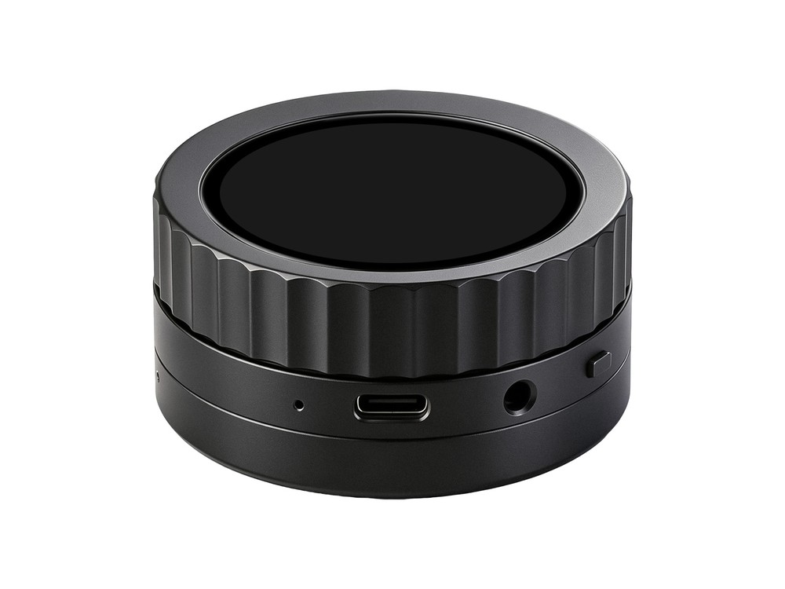

  <h1>ESP32-P4-Knob-Touch-AMOLED-1.75</h1>
  
<strong>ESP32-P4 1.75 英寸 466 × 466 MIPI-DSI AMOLED 触摸旋钮开发板</strong>

  
<a href="README.md">English</a> | <strong>简体中文</strong>

  

    
    
    
  

  

    <a href="https://www.waveshare.com/wiki/ESP32-P4-Knob-Touch-AMOLED-1.75">🌐 产品</a> &middot;
    <a href="#quick-start">📦 固件</a> &middot;
    <a href="examples/esp-idf/">🧩 ESP-IDF</a> &middot;
    <a href="examples/arduino/examples/">🔧 Arduino</a> &middot;
    <a href="#resources">📚 文档</a>
  

  

---

## ✨ 概述

本开发板将 ESP32-P4、圆形 AMOLED 触摸屏、旋钮方向输入和振动反馈集成在一起。本仓库提供 ESP-IDF、Arduino 外设示例与 ESP-Brookesia 出厂应用。

| 功能 | 器件或接口 |
| --- | --- |
| MCU | ESP32-P4NRW32X |
| 存储器 | 32 MB Flash，32 MB PSRAM |
| 显示 | 1.75 英寸、466 × 466 AMOLED，MIPI-DSI，CO5300 |
| 触摸 | CST9217，I2C |
| 无线 | 通过 SDIO 连接的 ESP32 协处理器 |
| 电源 / 时钟 / 运动 | AXP2101 PMU、PCF85063 RTC、QMI8658 IMU |
| 音频 | ES8389 编解码器、ES7210 麦克风 ADC；转接板搭载 NS4150B 功放 |
| 控制 | 旋钮方向开关、DRV8837 振动马达驱动 |
| 存储扩展 | microSD 接口 |
| 板级支持 | ESP Board Manager 与共用的 YAML 板级定义 |

## 📦 快速开始

在 [firmware/](firmware/) 目录下载文件名带 `FactoryOnly` 的固件，按[烧录说明](firmware/README_ZH.md)恢复出厂演示。也可从源码构建：

1. 安装并启用下方开发环境表中的 ESP-IDF 版本。
2. 下载或克隆仓库，在所选示例目录中打开终端。
3. 通过 USB 连接开发板，运行 `idf.py set-target esp32p4 build flash monitor`。
4. 按示例 README 连接需要的外设并查看预期现象；可先运行[系统信息示例](examples/esp-idf/01_system_info/README_ZH.md)，或构建[出厂应用](examples/factory/README_ZH.md)。

Arduino 开发请安装 **ESP32 by Espressif Systems** `3.3.12`，再打开 `examples/arduino/examples/` 中的草图。开发板选择 **ESP32P4 Dev Module**，并设置 Chip Variant 为 **v3.00 or newer**、Flash Size 为 **32 MB**、PSRAM 为 **Enabled**、Partition Scheme 为 **32M Flash (13MB APP/6.75MB SPIFFS)**。将 `examples/arduino/libraries/` 的内容（包括 `lv_conf.h`）复制到 Arduino sketchbook 的 libraries 目录，或在 Arduino CLI 中使用 `--libraries examples/arduino/libraries`。

`examples/esp-idf/` 下的 Arduino 组件示例将 Arduino 与 ESP-IDF 一同使用，不能在普通 Arduino IDE 中构建。请在所选示例目录运行 `idf.py set-target esp32p4 build flash monitor`。

## 🧪 示例

### ESP-IDF

| 示例 | 主要功能 |
| --- | --- |
| [01_system_info](examples/esp-idf/01_system_info/README_ZH.md) | 芯片、Flash、PSRAM 与内部内存信息 |
| [02_buttons](examples/esp-idf/02_buttons/README_ZH.md) | BOOT 和 PWR 按键状态日志 |
| [03_wifi](examples/esp-idf/03_wifi/README_ZH.md) | Wi-Fi 热点扫描 |
| [04_bluetooth](examples/esp-idf/04_bluetooth/README_ZH.md) | BLE GAP 扫描与汇总 |
| [05_axp2101](examples/esp-idf/05_axp2101/README_ZH.md) | 只读 PMU 状态显示 |
| [06_sd_card](examples/esp-idf/06_sd_card/README_ZH.md) | microSD 挂载与临时文件校验 |
| [07_limit_switches](examples/esp-idf/07_limit_switches/README_ZH.md) | 两路方向开关状态显示 |
| [08_motor_drive](examples/esp-idf/08_motor_drive/README_ZH.md) | 带自动停止的触摸振动控制 |
| [09_rtc](examples/esp-idf/09_rtc/README_ZH.md) | RTC 时间显示 |
| [10_qmi8658](examples/esp-idf/10_qmi8658/README_ZH.md) | 加速度曲线 |
| [11_display_touch](examples/esp-idf/11_display_touch/README_ZH.md) | RGB 显示与触摸绘点 |
| [12_mic_spectrum](examples/esp-idf/12_mic_spectrum/README_ZH.md) | 麦克风 FFT 频谱 |
| [13_speaker_output](examples/esp-idf/13_speaker_output/README_ZH.md) | 扬声器测试音播放 |
| [14_usb_display](examples/esp-idf/14_usb_display/README_ZH.md) | USB 显示接收端 |
| [15_lvgl_demo_v9](examples/esp-idf/15_lvgl_demo_v9/README_ZH.md) | LVGL 性能测试 |
| [16_a2dp_sink](examples/esp-idf/16_a2dp_sink/README_ZH.md) | 蓝牙音频接收与显示 |

### Arduino

| 示例 | 主要功能 |
| --- | --- |
| [01_system_info](examples/arduino/examples/01_system_info/README_ZH.md) | 芯片、Flash、PSRAM 与 Heap 信息 |
| [02_buttons](examples/arduino/examples/02_buttons/README_ZH.md) | BOOT 和 PWR 按键状态日志 |
| [05_axp2101](examples/arduino/examples/05_axp2101/README_ZH.md) | I2C 只读 PMU 状态 |
| [06_sd_card](examples/arduino/examples/06_sd_card/README_ZH.md) | microSD 挂载与临时文件校验 |
| [07_limit_switches](examples/arduino/examples/07_limit_switches/README_ZH.md) | 旋钮方向开关计数 |
| [08_motor_drive](examples/arduino/examples/08_motor_drive/README_ZH.md) | 带超时保护的振动马达控制 |
| [09_rtc](examples/arduino/examples/09_rtc/README_ZH.md) | RTC 时间输出 |
| [10_qmi8658](examples/arduino/examples/10_qmi8658/README_ZH.md) | 加速度输出 |
| [11_display_touch](examples/arduino/examples/11_display_touch/README_ZH.md) | 显示与连续触摸绘线 |
| [12_mic_spectrum](examples/arduino/examples/12_mic_spectrum/README_ZH.md) | 麦克风频谱显示 |
| [13_speaker_output](examples/arduino/examples/13_speaker_output/README_ZH.md) | 扬声器测试音播放 |
| [14_usb_display](examples/arduino/examples/14_usb_display/README_ZH.md) | Windows USB JPEG 扩展屏与 HID 触摸接收端 |
| [15_lvgl_demo_v9](examples/arduino/examples/15_lvgl_demo_v9/README_ZH.md) | LVGL 性能测试 |

传感器和控制示例通过 115200 波特率串口监视器输出；显示和触摸草图会在屏幕上显示结果。

### Arduino 作为 ESP-IDF 组件

| 示例 | 主要功能 |
| --- | --- |
| [03_wifi_arduino](examples/esp-idf/03_wifi_arduino/README_ZH.md) | 通过板载协处理器扫描 Wi-Fi 热点 |
| [04_bluetooth_arduino](examples/esp-idf/04_bluetooth_arduino/README_ZH.md) | 通过板载协处理器进行 BLE 扫描 |
| [16_a2dp_sink_arduino](examples/esp-idf/16_a2dp_sink_arduino/README_ZH.md) | 蓝牙 A2DP 音频接收 |

## 🛠️ 开发环境

| 开发框架 | 配置版本 | 示例数 |
| --- | --- | ---: |
| ESP-IDF 外设示例 | `v6.1` | 16 |
| Arduino 作为 ESP-IDF 组件 | `v6.1`，Arduino `3.3.12` | 3 |
| ESP-IDF 出厂应用 | `v6.1` | 1 |
| Arduino 示例 | `3.3.12` | 13 |

目标芯片为 `esp32p4`，框架配置统一记录在 [product.json](.github/product.json) 中。

ESP-IDF 与 Arduino 组件示例共用 `examples/esp-idf/common/waveshare_boards/` 中的 Board Manager 板定义，CMake 会在各自的构建目录生成配置表。若已安装 `esp-bmgr-assist`，构建时设置 `ESP_BOARD_MANAGER_SKIP_GEN_CHECK=1`，避免其源码目录预检查误判这些构建目录中的配置表。普通 Arduino 草图使用 `examples/arduino/libraries/` 下的 `board_config`、`board_display` 与 `board_audio` 库。

## 📚 资料

- [官方产品 Wiki（英文）](https://www.waveshare.com/wiki/ESP32-P4-Knob-Touch-AMOLED-1.75)

## 🤝 支持

- 产品使用、硬件或订单问题：[微雪技术支持](https://service.waveshare.com/)。

## 📄 许可证

除文件另有声明外，第一方内容采用 [Apache License 2.0](LICENSE)；随附第三方组件保留各自的许可证。
